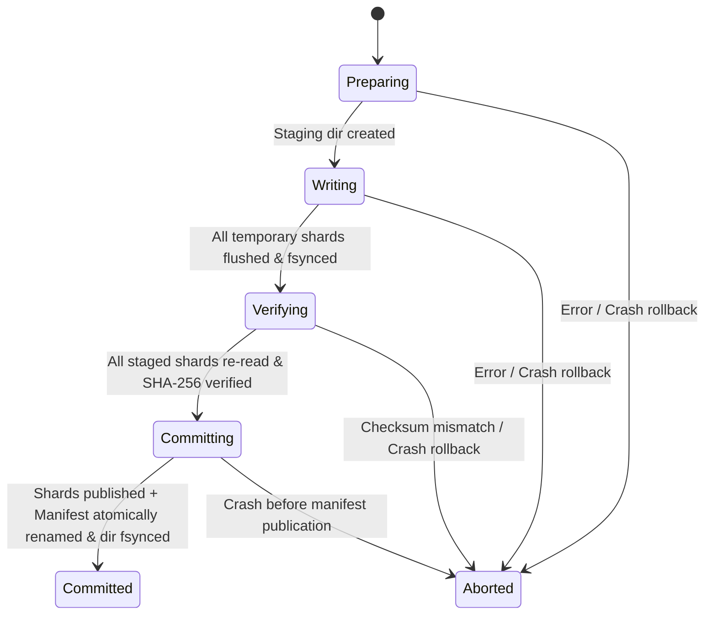

# FSP Phase 3 — Crash Consistency & Atomic Storage Transactions

## 1. Transaction State Machine

Every object write (`PUT`) executes under an explicit 6-state transaction journal persisted at `<root>/metadata/transactions/<tx_id>.tx.json` ([`src/storage/transaction.rs`](file:///home/rade/Project/Jobs/fsp/src/storage/transaction.rs)):

### State Definitions & Invariants
1. **`Preparing`:** Transaction metadata file `<tx_id>.tx.json` is written and synced; temporary staging directory `<root>/metadata/staging/<tx_id>/` is created.
2. **`Writing`:** Stripes are streamed from the input source, erasure-coded, and written to `<root>/metadata/staging/<tx_id>/stripe-XXXXXX.shard-YY.tmp`. Each staged shard file calls `File::sync_all()` before closing.
3. **`Verifying`:** Every staged shard file in `<root>/metadata/staging/<tx_id>/` is re-opened from disk, its byte length and SHA-256 digest are recomputed and compared against the expected `ShardPlacementRecord`. If any shard fails verification, the transaction transitions immediately to `Aborted`.
4. **`Committing`:**
   - Each verified staged shard file is atomically renamed (`std::fs::rename`) to its target node location `<root>/node-YY/objects/<object_id>/stripe-XXXXXX.shard-YY.v1.fsp`, and the parent directory is synced.
   - The validated `ObjectManifest` is written to `<root>/metadata/staging/<tx_id>/manifest.json.tmp` and synced via `File::sync_all()`.
   - **Unambiguous Commit Point:** `std::fs::rename` moves `manifest.json.tmp` to `<root>/metadata/manifests/<object_id>.manifest.json`, followed immediately by `sync_all()` on `<root>/metadata/manifests/`.
5. **`Committed`:** Transaction log `<tx_id>.tx.json` is updated to `Committed` and the empty `<root>/metadata/staging/<tx_id>/` directory is removed.
6. **`Aborted`:** Any staged files and any partially published shard files belonging to an uncommitted transaction are removed, and `<tx_id>.tx.json` is marked `Aborted`.

---

## 2. Crash Recovery Protocol (`RecoveryManager`)

On startup (or explicit `recover()` invocation), [`RecoveryManager`](file:///home/rade/Project/Jobs/fsp/src/recovery/recovery_manager.rs) scans `<root>/metadata/transactions/` and `<root>/metadata/staging/`:

- **Case 1 (`Preparing`, `Writing`, or `Verifying`):**
  The commit point (`<object_id>.manifest.json`) was never reached. All staged files in `<root>/metadata/staging/<tx_id>/` are deleted, and the transaction is transitioned to `Aborted`.
- **Case 2 (`Committing` without final `<object_id>.manifest.json`):**
  Process crashed after publishing some or all shard files to `node-XX/objects/<object_id>/`, but **before** the atomic rename of `<object_id>.manifest.json`. If no prior committed manifest exists for `<object_id>`, the uncommitted shard files published by `<tx_id>` are cleaned up, the staging directory is removed, and `<tx_id>` is transitioned to `Aborted`.
- **Case 3 (`Committing` with valid `<object_id>.manifest.json`):**
  Process crashed **after** the atomic manifest rename but before updating `<tx_id>.tx.json` to `Committed`. Recovery validates `<object_id>.manifest.json`, cleans up the residual staging directory, and transitions `<tx_id>` to `Committed`.
- **Orphaned Staging / Repair `.tmp` Files:**
  Any `.tmp` file in `metadata/staging/` or `node-XX/objects/` not associated with an active transaction is deleted.
- **Idempotency:** Executing recovery $N \ge 1$ times yields identical filesystem state and transaction states.

---

## 3. Filesystem, OS, and Hardware Durability Dependencies

> [!NOTE]
> **Explicit Durability Assumptions:**
> 1. **POSIX Atomic Rename within Same Mount:** `std::fs::rename` is atomic only when `<root>/metadata/staging/` and `<root>/node-XX/` (and `<root>/metadata/manifests/`) reside on the same filesystem mount, or when repairs stage `.tmp` files inside the target `node-XX/objects/<object_id>/` directory (which our repair engine always does).
> 2. **Kernel `fsync` & Disk Write-Cache Semantics:** Crash consistency across OS process kills (`SIGKILL` / `std::process::abort`) relies on POSIX kernel buffer visibility. True power-loss durability additionally depends on the underlying filesystem (`ext4` / `xfs` / `zfs` with barriers enabled) and physical storage controller honoring `fsync` / `FUA` (Force Unit Access) without volatile write-cache spoofing.
