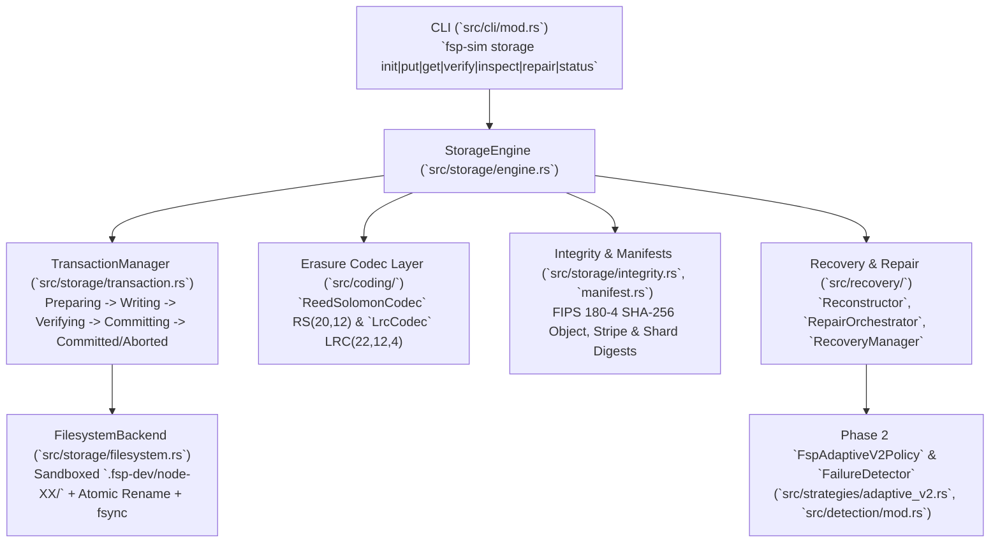

# FSP Phase 3 — Persistent Storage Engine Architecture

## 1. Architectural Overview

Phase 3 transitions FSP from a logical discrete-event simulator into a **byte-accurate, crash-safe persistent storage engine** while preserving the Phase 0–2 simulation modules completely intact and decoupled from host filesystem I/O.



---

## 2. Ten-Layer Separation of Concerns

| Layer | Module | Responsibility |
|---|---|---|
| 1. Object Ingestion | [`src/storage/object.rs`](file:///home/rade/Project/Jobs/fsp/src/storage/object.rs) | Bounded-memory streaming reader that slices arbitrary input streams (`0 B` to `100 MB+`) into deterministic stripes while computing the incremental object SHA-256 digest. |
| 2. Stripe Construction | [`src/coding/stripe.rs`](file:///home/rade/Project/Jobs/fsp/src/coding/stripe.rs) | Partitions each stripe of payload length $L_s \le \text{stripe\_size}$ into $k$ equal-sized, 8-byte-aligned data shard buffers with deterministic zero-padding for incomplete final stripes. |
| 3. Erasure Coding | [`src/coding/gf256.rs`](file:///home/rade/Project/Jobs/fsp/src/coding/gf256.rs), [`src/coding/reed_solomon.rs`](file:///home/rade/Project/Jobs/fsp/src/coding/reed_solomon.rs), [`src/coding/lrc.rs`](file:///home/rade/Project/Jobs/fsp/src/coding/lrc.rs), [`src/coding/codec.rs`](file:///home/rade/Project/Jobs/fsp/src/coding/codec.rs) | Systematic Cauchy $\text{RS}(20, 12)$ and Maximally Recoverable $\text{LRC}(22, 12, 4)$ / $\text{LRC}(20, 12, 4)$ encoding and Gauss–Jordan submatrix decoding over $\text{GF}(2^8)$. |
| 4. Shard Serialization | [`src/storage/object.rs`](file:///home/rade/Project/Jobs/fsp/src/storage/object.rs) | Binds each encoded shard to its stripe index, `ShardId`, `NodeId`, `FailureDomainId`, version number, byte length, and SHA-256 digest. |
| 5. Storage Backend | [`src/storage/backend.rs`](file:///home/rade/Project/Jobs/fsp/src/storage/backend.rs), [`src/storage/filesystem.rs`](file:///home/rade/Project/Jobs/fsp/src/storage/filesystem.rs) | Local filesystem backend managing independent node directories (`node-00`..`node-N`), capacity quotas, path-traversal/symlink protection, and deterministic fault injection. |
| 6. Object Metadata & Manifests | [`src/storage/manifest.rs`](file:///home/rade/Project/Jobs/fsp/src/storage/manifest.rs) | Canonical JSON manifest serialization, pre-allocation schema validation, placement mapping, and self-authenticating `manifest_digest`. |
| 7. Integrity Verification | [`src/storage/integrity.rs`](file:///home/rade/Project/Jobs/fsp/src/storage/integrity.rs) | Streaming FIPS 180-4 SHA-256 implementation verifying shard files prior to decoding, post-repair shard verification, and end-to-end reconstructed object verification. |
| 8. Reconstruction | [`src/recovery/reconstruct.rs`](file:///home/rade/Project/Jobs/fsp/src/recovery/reconstruct.rs) | Bounded-memory stripe-by-stripe object reader and decoder that filters out missing, corrupted, truncated, or stale shard versions and reproduces the exact original byte stream. |
| 9. Repair Orchestration | [`src/recovery/repair.rs`](file:///home/rade/Project/Jobs/fsp/src/recovery/repair.rs) | Integrates Phase 2 `FspAdaptiveV2Policy` and `FailureDetector` with physical shard verification to plan, execute, verify, and atomically publish repaired shards. |
| 10. Crash Consistency & Recovery | [`src/storage/transaction.rs`](file:///home/rade/Project/Jobs/fsp/src/storage/transaction.rs), [`src/recovery/recovery_manager.rs`](file:///home/rade/Project/Jobs/fsp/src/recovery/recovery_manager.rs) | Explicit 6-state write transaction journal, staging cleanup, interrupted repair cleanup, and idempotent startup crash recovery. |

---

## 3. On-Disk Layout & Logical Failure Domain Mapping

```text
<storage-root>/
  .fsp-marker                                    # Sentinel marker verifying initialized FSP root
  node-00/
    objects/<object_id>/stripe-000000.shard-00.v1.fsp
  node-01/
    objects/<object_id>/stripe-000000.shard-01.v1.fsp
  ...
  node-19/
    objects/<object_id>/stripe-000000.shard-19.v1.fsp
  metadata/
    manifests/<object_id>.manifest.json          # Atomic commit point for completed objects
    transactions/<tx_id>.tx.json                 # Crash-recovery write journal
    staging/<tx_id>/                             # Temporary unverified shard & manifest staging
```

> [!WARNING]
> **Physical Disk vs. Logical Failure Domain Boundary:**
> In single-host development and testing (`.fsp-dev/node-00` through `node-19`), separate subdirectories represent distinct storage nodes and failure domains **only at the logical protocol level**. Because all directories reside on the same underlying block device and filesystem, this configuration does **not** protect against physical host disk failure or kernel panic corrupting the shared filesystem. True physical failure-domain isolation requires mounting each `node-XX` directory on an independent physical disk or remote network storage node (Phase 4).
