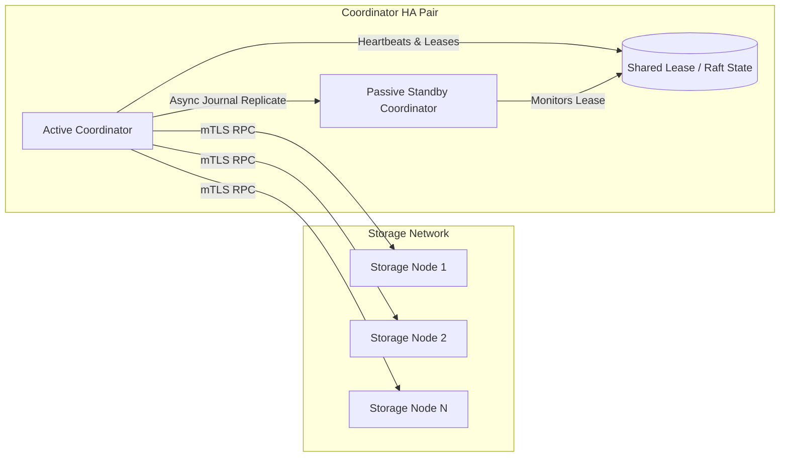

# FSP Phase 4.1 — Active/Passive Coordinator High Availability Architecture

## 1. Overview & Single Point of Failure Remediation

The coordinator manages manifest signatures, transaction coordination, and repair scheduling. To eliminate the coordinator as a single point of failure (SPOF):

## 2. Active/Passive Architecture

1. **Lease Fencing:** The Active Coordinator acquires an epoch-based lease with monotonic fencing tokens.
2. **Standby Failover:** If the active lease expires without renewal, the passive coordinator promotes itself, acquires the lease, replays the durable repair journal and generation watermarks, and assumes traffic.
3. **Storage Node Lease Enforcement:** Storage nodes reject requests carrying stale fencing tokens.
