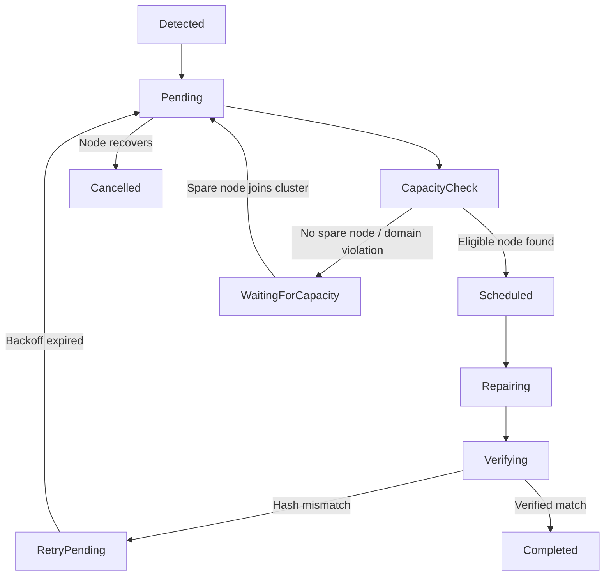

# FSP Phase 4.1 — Persistent Repair Queue & State Machine Specification

## 1. Overview & Architecture

The FSP Phase 4.1 Persistent Repair Queue is implemented by [`DurableRepairJournal`](file:///home/rade/Project/Jobs/fsp/src/coordinator/repair_journal.rs). Every repair job transitions through a strictly validated state machine with atomic `fsync` persistence to `<coord_root>/repair_jobs/<job_id>.rec`.

## 2. State Machine

## 3. Crash Recovery Semantics

Upon coordinator restart:
- Any repair jobs discovered in in-flight states (`Repairing`, `Scheduled`, `Verifying`, `CapacityCheck`) are automatically reset to `Pending`.
- An error marker (`interrupted by coordinator restart`) is recorded in the job journal.
- Jobs resume safely without duplicating shards or leaving partial allocations.
