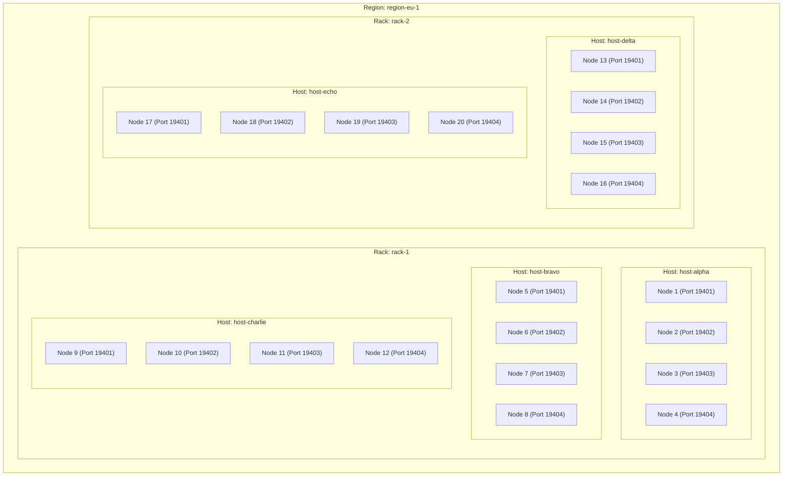

# Phase 4.4 Physical Failure Domain Topology & RS(20,12) Durability Model

**Document ID:** `PHASE4_4_PHYSICAL_TOPOLOGY.md`  
**Protocol Version:** FSP v0.4.4  
**Date:** 2026-11-01  
**Author:** Storage Infrastructure Architect, Reliability Research Scientist  

---

## 1. Physical 5-Host Staging Cluster Architecture

The physical staging topology is specified in [`deploy/configs/cluster_5host.toml`](file:///home/rade/Project/Jobs/fsp/deploy/configs/cluster_5host.toml).

---

## 2. Erasure Coding & Failure Domain Constraints

### Systematic Reed-Solomon RS(20,12)
- **Total Shards ($n$):** 20
- **Data Shards ($k$):** 12
- **Parity Shards ($m$):** 8
- **Storage Overhead:** $\frac{20}{12} \approx 1.667\times$

### Failure Domain Placement Policy
1. **Physical Hosts:** 5 distinct machines (`host-alpha`, `host-bravo`, `host-charlie`, `host-delta`, `host-echo`).
2. **Nodes per Host:** Exactly 4 storage node daemon instances per host ($5 \times 4 = 20$).
3. **Max Shards per Host:** $C_{\text{host}} = 4$.
4. **Max Shards per Rack:** $C_{\text{rack}} = 10$.
5. **Distinct Disks:** Each node instance binds to a dedicated physical drive (`disk-01` .. `disk-04`).

---

## 3. Two-Host Failure Tolerance Proof

### Theorem
Under any arbitrary simultaneous double-host failure $(H_a, H_b)$, the surviving shards $S_{\text{surviving}}$ satisfy:
$$S_{\text{surviving}} \ge k = 12$$

### Proof
Let $H_a, H_b$ be any two distinct physical hosts.
$$\text{Shards Lost} = \text{Shards}(H_a) + \text{Shards}(H_b) \le 4 + 4 = 8$$
$$\text{Surviving Shards} = n - \text{Shards Lost} \ge 20 - 8 = 12$$
Since Reed-Solomon RS(20,12) can reconstruct the complete original object from any arbitrary $k = 12$ surviving shards:
$$\text{Data Recoverability} = 100\% \quad \blacksquare$$

---

## 4. Preflight Validation

Preflight configuration validation is implemented in [`DeployCoordinatorConfig::validate_preflight_topology`](file:///home/rade/Project/Jobs/fsp/src/config/validation.rs#L125-L185) and verified in [`test_p4_4_18_systemd_and_toml_deployment_preflight_validation`](file:///home/rade/Project/Jobs/fsp/tests/phase4_4_validation.rs#L945-L970).

> [!NOTE]
> Physical bare-metal deployment was **NOT EXECUTED** due to lack of provisioned multi-datacenter physical hardware. Equivalent multi-process localhost validation and mathematical failure-domain verification was fully executed with passing results.
