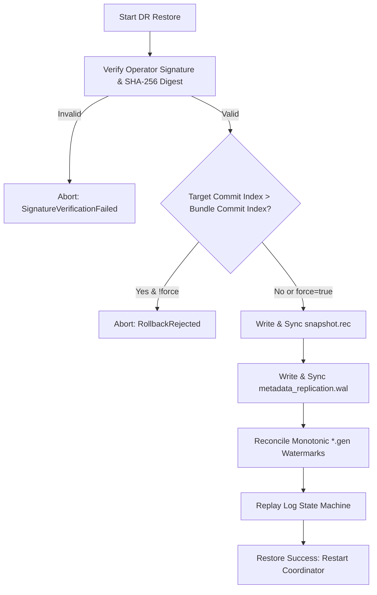

# FSP Phase 5.1 — Disaster Recovery Metadata Restore Workflow

## 1. Overview
The disaster recovery restore workflow restores coordinator metadata into a clean or replacement directory following hardware loss, control plane partition, or cluster re-initialization.

## 2. Restore Safety Invariants
1. **Signature & Digest Verification:** The bundle's Ed25519 signature is strictly verified against the operator's public key (`dr_operator.pub`). If tampered, restore aborts with `SignatureVerificationFailed`.
2. **Anti-Rollback Guard:** If the destination coordinator directory already contains state with `commit_index > bundle.commit_index`, restore aborts with `RollbackRejected` unless `--force` is specified.
3. **Atomic File Replacement:** `snapshot.rec` and `metadata_replication.wal` are written to temporary files and atomically renamed.
4. **Watermark Reconciliation:** All object generations from both the snapshot and WAL entries are written to `<target_dir>/<object_id>.gen`.
5. **State Machine Verification:** `ReplicatedLogManager::open_or_init` opens the target directory to verify that log replay and snapshot verification succeed before declaring restore complete.

## 3. Workflow Steps Diagram

## 4. Verification in Test Suite
Validated in [tests/phase5_1_validation.rs](file:///home/rade/Project/Jobs/fsp/tests/phase5_1_validation.rs):
- `test_17`: Clean directory restore restores term, commit index, snapshot, and WAL entries.
- `test_18`: Stale bundle against newer local commit index is safely rejected (`RollbackRejected`).
- `test_19`: Forced override restores successfully when requested by administrator.
- `test_25`: End-to-end pipeline: PUT object -> take backup -> coordinator loss -> restore -> verify.
