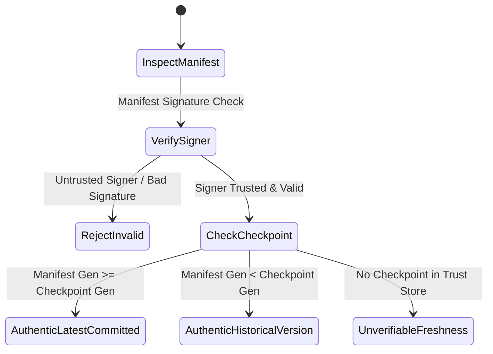

# FSP Phase 5.1 — Recovery Trust Model & Anti-Rollback Checkpoints

## 1. Overview
The Recovery Trust Model defines how FSP distinguishes authentic, authoritative storage state from stale, replayed, or malicious snapshots and manifests during disaster recovery and offline operations.

## 2. Components of RecoveryTrustStore
Implemented in [src/security/recovery_auth.rs](file:///home/rade/Project/Jobs/fsp/src/security/recovery_auth.rs), [`RecoveryTrustStore`](file:///home/rade/Project/Jobs/fsp/src/security/recovery_auth.rs) maintains three authoritative tables:

```rust
pub struct RecoveryTrustStore {
    pub trusted_manifest_signers: BTreeMap<String, VerifyingKey>,
    pub trusted_recovery_principals: BTreeMap<String, VerifyingKey>,
    pub known_checkpoints: BTreeMap<String, u64>,
}
```

1. **`trusted_manifest_signers`**: Pinned public keys of coordinators and authorities authorized to seal immutable object manifests.
2. **`trusted_recovery_principals`**: Pinned public keys of cluster administrators and tenant owners authorized to sign offline `RecoveryCapabilityToken`s.
3. **`known_checkpoints`**: Monotonically advancing generation checkpoints recorded from surviving consensus logs or verified backup snapshots.

## 3. Anti-Rollback Checkpoint Invariant
When storage nodes participate in the cluster, they persist their highest seen object generation in `<node_root>/<object_id>.gen`. During disaster recovery:
- If a manifest presented for recovery has `manifest_generation < checkpoint_generation`, it is classified as `AuthenticHistoricalVersion`.
- If an operator attempts to restore a metadata snapshot with `snapshot_index < local_commit_index`, the restore engine refuses the rollback with `RollbackRejected` unless explicit `--force` override is supplied.

## 4. Freshness State Machine



## 5. Security Guarantees
- **No Unsigned Recovery:** Shards alone cannot be decoded into an object without a valid Ed25519-signed manifest.
- **Rollback Visibility:** Reconstructing older versions produces an explicit warning and classification in the audit trail, preventing operators from unknowingly serving stale state as latest.
