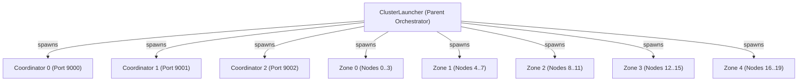

# Phase 5.4 Executable Cluster Architecture & Process Lifecycle

## 1. Overview
In Phase 5.4, FSP transitioned from in-process mock networking to real OS subprocess execution using [`src/cluster/launcher.rs`](file:///home/rade/Project/Jobs/fsp/src/cluster/launcher.rs) and the [`fsp-node`](file:///home/rade/Project/Jobs/fsp/src/bin/fsp-node.rs) binary.

## 2. Cluster Launcher Architecture

The launcher manages:
1. **3 Coordinators:** Form a Raft-style metadata quorum on independent ports.
2. **20 Storage Nodes:** 4 nodes in each of 5 failure zones (Zones 0 through 4).
3. **mTLS Infrastructure:** Ephemeral Ed25519/ECDSA certificates provisioned per node under `target/phase5_4_pki/`.
4. **Readiness Synchronization:** Subprocesses write their ephemeral socket and port to `--ready-file <path>`. The parent process polls for up to 5000ms until the file appears and contains valid metadata.



## 3. CLI Options Implemented in `fsp-node`

```bash
fsp-node [OPTIONS]

Options:
  --mode <MODE>               Mode: 'coordinator', 'storage', or 'standalone'
  --node-id <ID>              Integer node identifier (0..19)
  --zone-id <ZONE>            Failure zone identifier (0..4)
  --bind <ADDR:PORT>          Listen address for TCP/TLS RPC
  --data-dir <PATH>           Path for persistent shard containers and WAL
  --coordinator <ADDR:PORT>   Coordinator endpoint for node registration
  --ready-file <PATH>         Path where node writes readiness token once bound
  --tls-ca <PATH>             Path to root CA cert for mutual TLS
  --tls-cert <PATH>           Path to node x509 cert
  --tls-key <PATH>            Path to node private key
  --coordinator-id <ID>       Coordinator instance ID (0..2)
  --coordinator-bind <ADDR>   Coordinator listen socket
  --coordinator-peers <ADDRS> Comma-separated peer list for quorum
```

## 4. Process Lifecycle & Teardown

- **Graceful Shutdown:** `ClusterLauncher::stop()` sends `SIGTERM` to all child processes and waits up to 2 seconds for clean WAL flush before escalating.
- **SIGKILL Fault Injection:** Direct OS `kill(pid, SIGKILL)` simulates unannounced crash events without flushing disk buffers.
- **RAII Drop Implementation:** `ClusterLauncher` implements `Drop`, ensuring all spawned child processes are killed and cleaned up automatically if a test or thread panics, preventing zombie processes.
