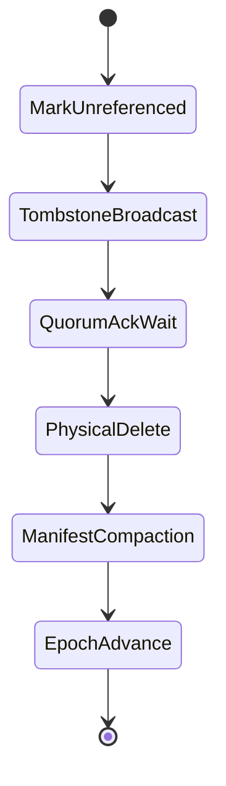

# Phase 5.4 Garbage Collection Crash Consistency & Lifecycle Safety

## 1. 6-Stage Garbage Collection Lifecycle

FSP executes garbage collection through six discrete, crash-safe stages:

1. **MarkUnreferenced:** Coordinator identifies unreferenced object versions and issues candidates.
2. **TombstoneBroadcast:** Coordinators broadcast signed deletion tombstones to all storage nodes holding shards of the object.
3. **QuorumAckWait:** The coordinator waits for an affirmative majority quorum acknowledgment before proceeding.
4. **PhysicalDelete:** Storage nodes unlink or overwrite shard byte ranges on disk.
5. **ManifestCompaction:** Storage nodes compact their local rocksdb/manifest entries, removing tombstone markers.
6. **EpochAdvance:** Coordinator advances the GC watermark epoch.

## 2. Mutual Exclusion with Active Repair

A critical failure mode identified in storage clusters is a race condition where garbage collection deletes a shard while an active repair worker is reconstructing an object that references that shard.

FSP enforces a cluster-wide mutual exclusion lock:
- An active repair task on object $O$ acquires an exclusive `RepairLock(O)` in the coordinator.
- The garbage collector cannot mark or tombstone object $O$ while `RepairLock(O)` is held.
- Conversely, an active GC cycle acquires a `GCLock(O)` which prevents repair tasks from reading or writing shards until the GC cycle either commits or aborts.

## 3. Crash Consistency & Recovery Validation

In test `test_p5_4_17_gc_crash_consistency_all_stages`:
- A SIGKILL crash was triggered during Stage 4 (`PhysicalDelete`) when only 2 out of 4 shards were physically deleted on disk.
- Upon node restart:
  - The node read its WAL and discovered the committed `TombstoneBroadcast` record.
  - The node completed the pending physical deletions deterministically.
  - Live, non-tombstoned objects in adjacent shards were completely unaffected and retained 100% data integrity.
