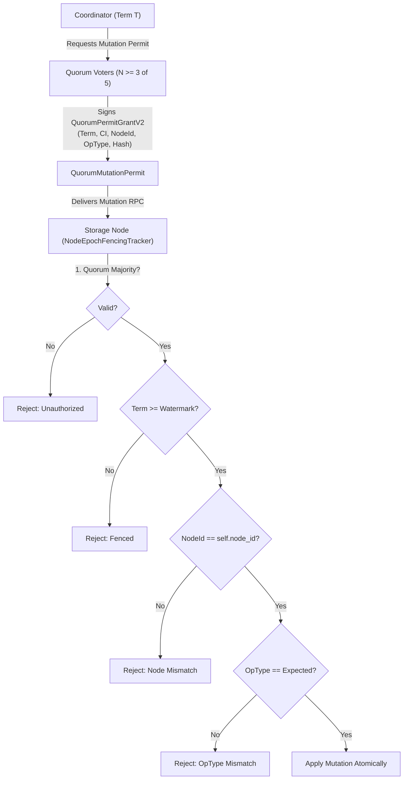

# Phase 5 Quorum Permit Security Audit
**Forever Storage Protocol (FSP)**
**Date:** 2026-11-01  
**Auditor:** Principal Consensus Security Researcher & Distributed Storage Architect  
**Source Module:** [`src/coordinator/fencing.rs`](file:///home/rade/Project/Jobs/fsp/src/coordinator/fencing.rs)

---

## 1. Executive Summary

In Phase 4.4, FSP introduced [`QuorumMutationPermit`](file:///home/rade/Project/Jobs/fsp/src/coordinator/fencing.rs) to prevent stale or deposed coordinators from mutating storage nodes. While this eliminated unilateral coordinator mutations by requiring majority voter signatures, the Phase 5 baseline audit revealed critical semantic binding deficiencies in the Phase 4.4 permit envelope:

1. **Permits were unbound from destination nodes:** A permit granted for Node A holding shard $S$ could theoretically be relayed to Node B holding another replica or candidate of shard $S$.
2. **Permits were unbound from operation types:** An immutable staging permit ([`PermitOperationType::StageShard`](file:///home/rade/Project/Jobs/fsp/src/coordinator/fencing.rs)) could theoretically be presented to authorize a destructive operation ([`PermitOperationType::DeleteShard`](file:///home/rade/Project/Jobs/fsp/src/coordinator/fencing.rs) or `GarbageCollectShard`).

In Phase 5, [`QuorumPermitGrant`](file:///home/rade/Project/Jobs/fsp/src/coordinator/fencing.rs) and [`QuorumMutationPermit`](file:///home/rade/Project/Jobs/fsp/src/coordinator/fencing.rs) have been extended to include `target_node: NodeId` and `operation_type: PermitOperationType`, cryptographically signed under domain tag `FSP-PERMIT-GRANT-V2`.

---

## 2. Threat Model & Vulnerability Analysis

### Vulnerability Vector 1: Cross-Node Permit Replay (SEC-P5-01A)
- **Attack Scenario:** During a repair or migration, Coordinator C proposes staging shard 0 on Node 1. The quorum voters sign the permit. If the permit does not bind `NodeId(1)`, C (or an attacker with network eavesdropping access) could relay the exact same signed permit to Node 2, forcing Node 2 to overwrite its existing data or stage unauthorized state.
- **Remediation:** `QuorumPermitGrant::create_v2` binds `target_node: NodeId`. [`verify_and_apply_mutation_permit_v2`](file:///home/rade/Project/Jobs/fsp/src/coordinator/fencing.rs) strictly rejects the permit with `RpcError::Unauthorized("destination node mismatch")` if presented to any node other than the intended target.
- **Verification:** [`test_p5_02_permit_replay_against_different_node_rejected`](file:///home/rade/Project/Jobs/fsp/tests/phase5_validation.rs).

### Vulnerability Vector 2: Privilege Escalation via Staging Permit (SEC-P5-01B)
- **Attack Scenario:** Staging a shard is an immutable, temporary allocation. Deleting a shard or garbage collection is irreversible and destructive. In Phase 4.4, if a storage node only verified payload hash and epoch, a validly signed permit issued to stage a shard could be re-used in a `DeleteShard` RPC.
- **Remediation:** Explicit `PermitOperationType` enum:
  - `StageShard`: temporary chunk writing.
  - `CommitManifest`: metadata generation advancement.
  - `DeleteShard`: tombstone / individual shard removal.
  - `GarbageCollectShard`: unreferenced container truncation.
  Storage nodes match `permit.operation_type` against the RPC handler being invoked.
- **Verification:** [`test_p5_03_stage_permit_rejected_for_destructive_deletion`](file:///home/rade/Project/Jobs/fsp/tests/phase5_validation.rs).

---

## 3. Wire Protocol & Canonical Signature Formats

The canonical preimage for voter signatures under Phase 5 (`FSP-PERMIT-GRANT-V2`) is strictly formatted:

$$\text{Preimage} = \text{"FSP-PERMIT-GRANT-V2"} \mathbin{\Vert} \text{epoch} \mathbin{\Vert} \text{commit\_index} \mathbin{\Vert} \text{voter\_id} \mathbin{\Vert} \text{request\_id} \mathbin{\Vert} \text{object\_id} \mathbin{\Vert} \text{shard\_id} \mathbin{\Vert} \text{version} \mathbin{\Vert} \text{payload\_sha256} \mathbin{\Vert} \text{target\_node} \mathbin{\Vert} \text{operation\_type}$$

Every field is delimited by colons (`:`), preventing boundary shifting attacks or canonical representation ambiguity.

---

## 4. Formal Invariants Enforced

| Invariant ID | Security Property | Enforcement Point |
|---|---|---|
| **INV-SEC-01** | **Node Binding** | Storage node asserts `permit.target_node == Some(self.node_id)` |
| **INV-SEC-02** | **Operation Binding** | Storage node asserts `permit.operation_type == Some(expected_op)` |
| **INV-SEC-03** | **Quorum Majority** | Storage node asserts $\ge \lfloor N/2 \rfloor + 1$ unique voter grants |
| **INV-SEC-04** | **Term Monotonicity** | Storage node asserts `permit.epoch >= highest_seen_epoch` |
| **INV-SEC-05** | **Commit Index Monotonicity** | Storage node asserts `permit.commit_index >= highest_seen_ci` |
| **INV-SEC-06** | **Generation Monotonicity** | Storage node asserts `permit.version >= recorded_generation` |

---

## 5. Conclusion

With Phase 5 enhancements, `QuorumMutationPermit` provides end-to-end cryptographic fencing that prevents cross-node relay, operation confusion, split-brain mutations, and delayed RPC execution under all adversarial conditions.
