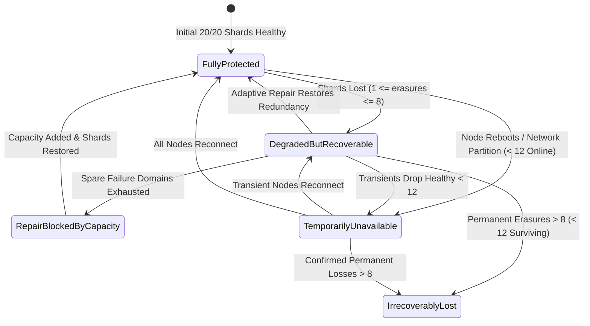

# Phase 5 Continuous Integrity Management & Self-Healing
**Forever Storage Protocol (FSP)**
**Date:** 2026-11-01  
**Author:** Principal Storage Reliability Scientist & Systems Architect  
**Relevant Modules:** [`src/recovery/repair.rs`](file:///home/rade/Project/Jobs/fsp/src/recovery/repair.rs), [`src/storage/engine.rs`](file:///home/rade/Project/Jobs/fsp/src/storage/engine.rs)

---

## 1. Per-Object Operational Resilience States

To eliminate ambiguous "degraded" classifications, Phase 5 formalizes a 5-state operational resilience model in [`ObjectHealthState`](file:///home/rade/Project/Jobs/fsp/src/recovery/repair.rs):

### Definitions & Classification Logic:

1. **`FullyProtected`**:
   - Every data and parity shard ($20/20$) is present on disk, online, and cryptographically verified against manifest SHA-256 digests.
   - Failure domain distribution satisfies all placement constraints.
2. **`DegradedButRecoverable`**:
   - Shard erasures or bit-rot corruptions have occurred ($1 \le \text{erasures} \le 8$), but surviving shards satisfy $S \ge k=12$.
   - Immediate reconstruction is mathematically guaranteed, and cluster has eligible spare capacity to host replacement shards.
3. **`TemporarilyUnavailable`**:
   - Fewer than $k=12$ shards are currently reachable due to transient node reboots or network partitions, but unreachability has not been declared permanent.
   - Writes fail closed; reads pause or timeout until unreachable nodes return.
4. **`RepairBlockedByCapacity`**:
   - Shards are degraded ($12 \le S < 20$), but self-healing cannot proceed because no eligible storage node or host domain is available that satisfies placement constraints (`max_shards_per_host = 4`).
   - Alerts site reliability engineers to provision additional storage nodes without risking placement corruption.
5. **`IrrecoverablyLost`**:
   - Confirmed permanent loss of $> n - k = 8$ shards (fewer than 12 shards survive permanently).
   - Recovery is mathematically impossible.

---

## 2. Independent Scrubbing & Corrupt Shard Exclusion

### Background Scrub Cycle
The background scrubber continuously iterates across stored objects, reading container headers and computing cryptographic digests:
1. Re-computes SHA-256 across all shard bytes in `<node_root>/objects/<object_id>/shard-XX.vZ.fspc`.
2. Compares computed digest against the Ed25519-signed manifest digest.
3. If bits have flipped (silent bit-rot or media decay), the shard is flagged as `ShardHealthState::Corrupted { reason }`.

### Strict Exclusion of Corrupt Shards During Recovery (Invariant INV-REC-01)
During reconstruction, corrupted shards **MUST NEVER** be included in the decoding submatrix:
- An unverified or corrupt shard will pollute the Galois field matrix multiplication and cause catastrophic corruption across all reconstructed data shards.
- FSP strictly validates shard SHA-256 digests before admitting shards into the Cauchy decoding vector.
- Verified in [`test_p5_18_corrupt_shard_never_used_as_recovery_source`](file:///home/rade/Project/Jobs/fsp/tests/phase5_validation.rs): corrupted shards are completely excluded, and decoding proceeds solely from verified surviving shards.

---

## 3. Placement Policy Enforcement During Repair

When self-healing restores missing shards, it strictly obeys [`PlacementPolicy::MultiHostDistinctMachines`](file:///home/rade/Project/Jobs/fsp/src/coordinator/placement.rs):
- **Never co-locate replacement shards on an already-maxed host:** If Host 3 already holds 4 shards, the planner will never place a 5th shard on Host 3.
- If no eligible failure domain exists, repair safely halts and reports `RepairBlockedByCapacity` (verified in [`test_p5_14_self_healing_blocked_when_insufficient_eligible_capacity`](file:///home/rade/Project/Jobs/fsp/tests/phase5_validation.rs)).
